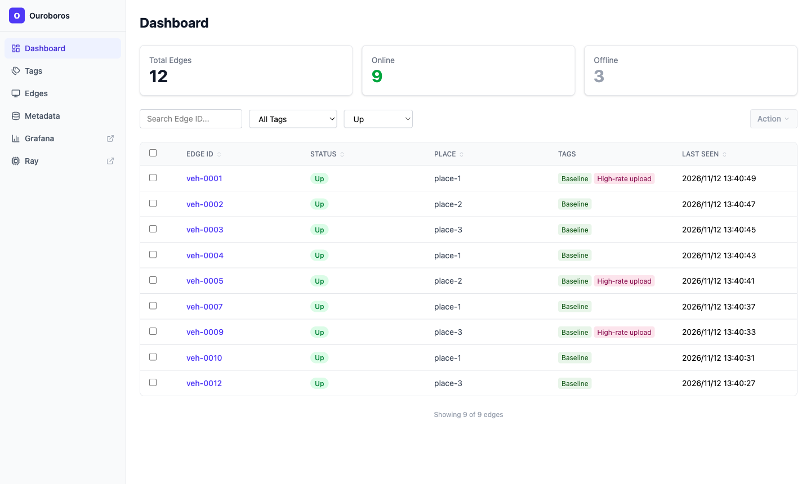
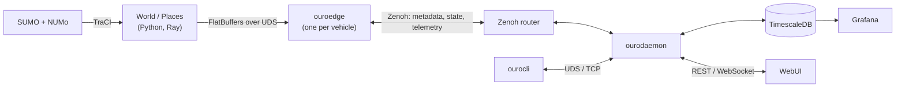

<p align="center">
  
</p>

# The Ouroboros Platform

[](https://github.com/ToyotaInfoTech/ouroboros/actions/workflows/ci.yml)
[](LICENSE)


> [!WARNING]
> **Experimental platform.** This repository is a research prototype. No guarantees of stability, security, or backward compatibility are made.
> APIs, schemas, and behaviors may change without notice. Not recommended for production use.

Ouroboros is an end-to-end experimental platform for studying cost-aware vehicle-to-cloud data collection.
It lets you simulate vehicles, distribute edge-side processing, and evaluate how "what to upload, when to upload, and over which network" decisions affect cost and data value.



*The WebUI dashboard showing simulated edges (sample data).*

## Why Ouroboros

In connected-vehicle workflows, raw data is expensive to move (especially over cellular), while metadata is cheaper and might be sufficient for planning.
Ouroboros focuses on a practical loop:

1. Sense broadly to produce lightweight metadata.
2. Upload metadata early (cellular-friendly).
3. Plan centrally using the metadata.
4. Instruct vehicles to upload only what is needed (timing and path, such as Wi-Fi vs. cellular).
5. Iterate as evidence accumulates.

The goal is to reduce transfer cost without losing the ability to find and retrieve valuable "platinum" data.

## Architecture

The repository is a testbed with three layers:

- **Traffic simulation**: [SUMO](https://eclipse.dev/sumo/) with scenarios such as [NUMo](https://github.com/ToyotaInfoTech/numo), read per vehicle via [TraCI](https://sumo.dlr.de/docs/TraCI/).
- **Distributed edge**: a [Ray](https://docs.ray.io/) cluster (a **World** head node and **Place** workers) feeds simulated sensor data to one `ouroedge` process per vehicle over Unix Domain Sockets.
- **Cloud center**: `ourodaemon` ingests metadata into TimescaleDB, serves the WebUI and the `ourocli` CLI, and issues adaptive collection instructions.



See [docs/ARCHITECTURE.md](docs/ARCHITECTURE.md) for the component diagrams, sequence diagrams and state design.

## Quick Start

This runs the whole platform on one machine.

### Prerequisites

| Tool | Version | Purpose |
| --- | --- | --- |
| [Rust](https://www.rust-lang.org/tools/install) | 1.93+ | Daemon, edge and CLI |
| [uv](https://docs.astral.sh/uv/getting-started/installation/) | 0.9.11+ | Python environment (Python 3.13) |
| [Node.js](https://nodejs.org/) | 20+ | WebUI build |
| [SUMO](https://sumo.dlr.de/docs/Installing/index.html) | 1.25+ | Traffic simulation |
| [Docker](https://docs.docker.com/get-docker/) | recent | TimescaleDB and Grafana |
| [Zenoh router](https://zenoh.io/docs/getting-started/installation/) (`zenohd`) | 1.x | Messaging |
| [cargo-make](https://github.com/sagiegurari/cargo-make) | 0.37.24 | Task runner (`cargo install cargo-make@0.37.24`) |

### Build

```bash
git clone https://github.com/ToyotaInfoTech/ouroboros.git
cd ouroboros
git clone https://github.com/ToyotaInfoTech/numo.git ~/numo   # traffic scenarios, expected at $NUMO_HOME (default: ~/numo)

uv sync                                                        # Python environment
cargo make bweb                                                # WebUI (embedded into the daemon)
cargo build --workspace --release --target "$(rustc -vV | awk '/host:/ {print $2}')"
```

### Configure credentials

No default passwords are shipped. Copy the example and replace every `CHANGE_ME`:

```bash
cp examples/dot.env.example .env
openssl rand -hex 24   # generate a value for each CHANGE_ME
```

### Run

Open a terminal per long-running command, and run `source setenv local` in each of them first.
`setenv` activates the Python environment, loads `.env` and selects the `local` configuration.

```bash
source setenv local
cargo make cup      # TimescaleDB + Grafana containers
cargo make zup      # Zenoh router
cargo make oup      # ourodaemon (follows its log; keep this terminal open)
```

```bash
source setenv local
./bin/run-launch    # SUMO + World/Places + edges
```

Then open:

| URL | Service |
| --- | --- |
| <http://localhost:3001> | Ouroboros WebUI |
| <http://localhost:3000> | Grafana |
| <http://localhost:8080/metrics> | Daemon metrics |
| <http://localhost:8265> | Ray dashboard |

Stop the services with `cargo make adown`, and see [docs/USAGE.md](docs/USAGE.md) for the CLI, log replay tools and more.
For a multi-node cluster, see [docs/DEPLOYMENT.md](docs/DEPLOYMENT.md) and [docs/DEMO.md](docs/DEMO.md).

## Documentation

| Document | Contents |
| --- | --- |
| [docs/ARCHITECTURE.md](docs/ARCHITECTURE.md) | Components, communication, state, sequence diagrams |
| [docs/USAGE.md](docs/USAGE.md) | Running the platform and the JSONL tools |
| [docs/DEPLOYMENT.md](docs/DEPLOYMENT.md) | Multi-node setup: host requirements, file sync, remote tasks |
| [docs/DEMO.md](docs/DEMO.md) | Step-by-step cluster demo |
| [docs/WebUI.md](docs/WebUI.md) | WebUI architecture, REST API, WebSocket events |
| [docs/DEVELOPMENT.md](docs/DEVELOPMENT.md) | Project structure, building, testing, crate dependencies |
| [docs/SECURITY_CONSIDERATIONS.md](docs/SECURITY_CONSIDERATIONS.md) | Exposed ports, tokens, credentials |
| [docs/profiling.md](docs/profiling.md) | Profiling the Python and Rust components |
| [docs/VISUAL_IDENTITY.md](docs/VISUAL_IDENTITY.md) | Logo variants and usage |
| [Python API](https://toyotainfotech.github.io/ouroboros/python/index.html), [Rust API](https://toyotainfotech.github.io/ouroboros/rust/index.html) | Generated API documentation |

## Security

Ouroboros is a research prototype, so run it only on networks you trust.
The WebUI and metrics servers listen on `127.0.0.1` by default, and the Zenoh router sample listens on all interfaces.
Read [docs/SECURITY_CONSIDERATIONS.md](docs/SECURITY_CONSIDERATIONS.md) before exposing any port, and report vulnerabilities as described in [SECURITY.md](SECURITY.md).

## Contributing

Contributions are welcome. Please read [CONTRIBUTING.md](CONTRIBUTING.md) first.

## License

Licensed under the [Apache License, Version 2.0](LICENSE). See [NOTICE](NOTICE) for copyright information.

## Acknowledgments

We would like to express our gratitude to the [NUMo project](https://github.com/ToyotaInfoTech/numo) for providing the foundation for our traffic simulation layer.
NUMo's integration with SUMO has been instrumental in enabling realistic vehicle behavior modeling in this platform.

## References

- Ray Documentation: <https://docs.ray.io/>
- Eclipse Zenoh: <https://zenoh.io/>
- SUMO Wiki: <https://sumo.dlr.de/docs/>
- FlatBuffers: <https://flatbuffers.dev/>
