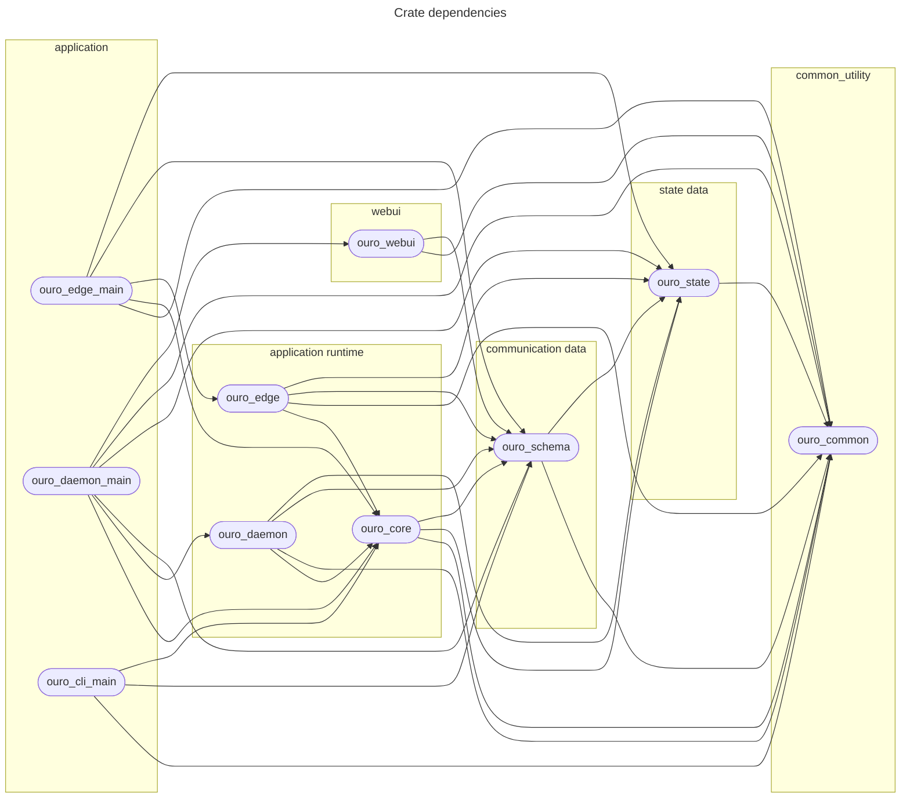

# Development

## Project Structure

### Core Components

- `python/` — Python package root
  - `edge/` — Edge communication (IPC, RPC, UDS)
  - `gen/` — FlatBuffers generated code
  - `message/` — Message definitions
  - `router/` — Routing logic (SUMO integration)
  - `world/` — World and cluster management (Ray)
  - `tool/` — Utilities for JSONL processing
  - `tests/` — Unit tests

- `crates/` — Rust crates (see Crate dependencies diagram below for details)

- `schema/fb/` — FlatBuffers schemas
  - `peer.fbs` — Peer message definitions
  - `rpc.fbs` — RPC protocol definitions

- `bin/` — Orchestration scripts
  - `run-launch` — Local launch runner
  - `run-remote-launch` — Remote deployment runner
  - `run-sim` — SUMO simulation runner
  - `gen-fb` — FlatBuffers code generator
  - `ouro-sync` — rsync-based file sync to remote hosts
  - `remote-helper.sh` — Remote execution helper for cargo-make tasks
  - `parse-hosts.py` — Host configuration parser (`etc/hosts.toml`)
  - `filter-jsonl` — Log filtering utility
  - `play-jsonl` — Log replay utility

### Configuration

- `Cargo.toml` — Rust project settings
- `pyproject.toml` — Python project settings
- `uv.lock` - UV environment lock file
- `etc/` — Configuration files
  - `hosts.toml` — Remote host definitions (address, user, roles)
  - `sync-<role>.rules` — rsync filter rules per role (`cloud`, `head`, `work`, `all`)
  - `logging.yaml` — Logging configuration
  - `sumo-scenarios/` — SUMO scenario files
  - `daemon_config_local.toml` — Daemon config for local development
  - `daemon_config_ray.toml` — Daemon config for Ray cluster deployment
  - `edge_config_{base,full}_local.toml` — Edge configs for local development
  - `edge_config_{base,full}_ray.toml` — Edge configs for Ray cluster deployment

> **Note:** Config files are selected automatically based on the `WORLD_MODE` environment variable (`local` or `ray`).
> Set it by sourcing `setenv`: `source setenv local` or `source setenv ray`.

## Development

### Code Generation

Regenerate FlatBuffers code after schema changes:

```bash
./bin/gen-fb
```

### Testing

```bash
# Python tests
python -m pytest python/tests/

# Rust tests
cargo test --workspace
```

### Building

```bash
# Build all Rust binaries for the host
cargo build --workspace --release --target "$(rustc -vV | awk '/host:/ {print $2}')"
```

### Cargo tools

```bash
cargo install cargo-make@0.37.24
```

## Crate dependencies


