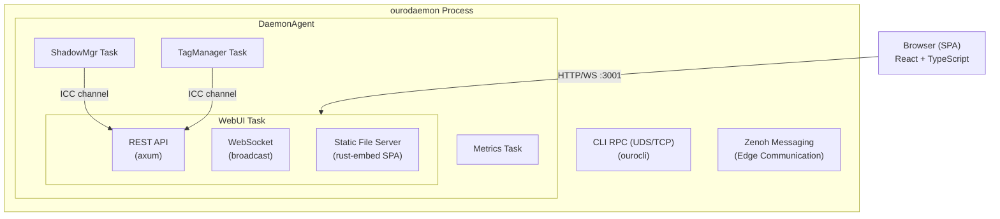
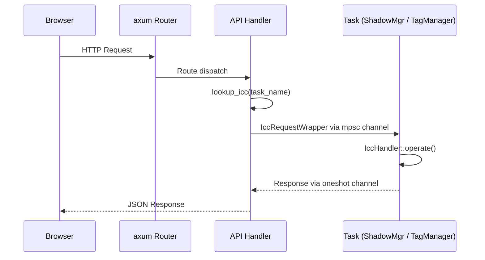
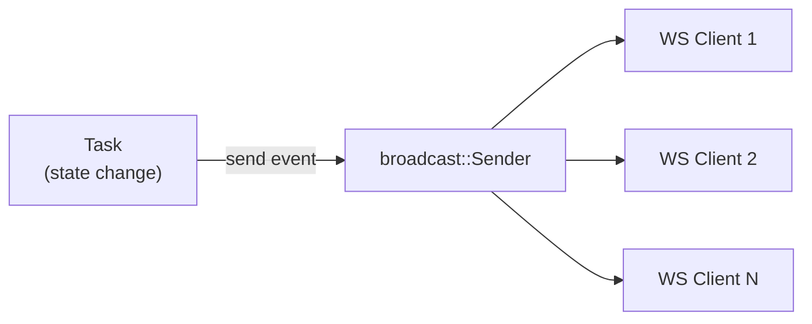

# Ouroboros Dashboard WebUI

An interactive dashboard WebUI embedded in the Ouroboros daemon.
It provides browser-based access to all operations supported by ICC (Inter-Component Communication),
including edge device state monitoring, tag CRUD, shadow management, and configuration changes.

---

## Table of Contents

- [Architecture Overview](#architecture-overview)
- [Tech Stack](#tech-stack)
- [Directory Structure](#directory-structure)
- [Data Flow](#data-flow)
- [REST API Endpoints](#rest-api-endpoints)
- [WebSocket Events](#websocket-events)
- [Configuration](#configuration)
- [Getting Started](#getting-started)
- [Development Guide](#development-guide)

---

## Architecture Overview



### Design Principles

| Principle | Description |
| ----------- | ------------- |
| **Single Binary** | SPA static files are embedded in the `ourodaemon` binary via `rust-embed`. No additional web server or process required. |
| **Operations via ICC** | The WebUI does not introduce its own data access layer. All operations go through existing ICC channels, providing full parity with the CLI (`ourocli`). |
| **Real-time Updates** | WebSocket event streaming pushes edge state changes and tag modifications to the browser instantly. No polling required. |
| **Optional Token Authentication** | Binds to loopback by default. Set `auth_token` to require `Authorization: Bearer <token>` on `/api/v1`; cross-origin requests are always rejected. See [Security](#security). |

---

## Tech Stack

### Backend

| Component | Technology | Purpose |
| ----------- | ----------- | --------- |
| HTTP Server | axum 0.8 | REST API + WebSocket + static file serving |
| Request guard | axum middleware | Same-origin check and optional bearer token |
| WebSocket | axum built-in (ws feature) | Real-time event delivery |
| Event Broadcast | tokio::sync::broadcast | Fan-out to WebSocket clients |
| Static Files | rust-embed 8 | SPA asset embedding in binary |
| Serialization | serde_json | JSON conversion for REST API |

### Frontend

| Component | Technology | Purpose |
| ----------- | ----------- | --------- |
| UI Framework | React 19 + TypeScript | SPA |
| Build Tool | Vite 8 | Dev server + production build |
| CSS | Tailwind CSS v4 | Utility-first styling |
| Routing | TanStack Router | Type-safe client-side routing |
| Data Fetching | TanStack Query | API cache + automatic refetching |
| Icons | Lucide React | SVG icon set |

---

## Directory Structure

### Backend (`crates/ouro_webui/`)

```
crates/ouro_webui/
├── Cargo.toml
└── src/
    ├── lib.rs               # Router builder, event channel
    ├── auth.rs              # Same-origin check and bearer token guard
    ├── event.rs             # DashboardEvent enum (WS broadcast events)
    ├── static_files.rs      # SPA static file serving via rust-embed
    └── api/
        ├── mod.rs           # AppState definition, route aggregation
        ├── shadows.rs       # Shadow CRUD endpoints + icc_operate helper
        ├── tags.rs          # Tag CRUD + assign/unassign endpoints
        ├── system.rs        # Health check endpoint
        └── ws.rs            # WebSocket real-time event stream
```

### Frontend (`webui/`)

```
webui/
├── package.json
├── vite.config.ts           # Vite config (Tailwind plugin, API proxy)
├── tsconfig.json
├── index.html               # SPA entry point
└── src/
    ├── main.tsx             # React + TanStack Query + Router bootstrap
    ├── router.ts            # Route definitions (TanStack Router)
    ├── index.css            # Tailwind CSS v4 import
    ├── lib/
    │   └── utils.ts         # cn() utility (clsx + tailwind-merge)
    ├── api/
    │   ├── types.ts         # TypeScript type definitions matching Rust types
    │   └── client.ts        # REST API client (fetch-based)
    ├── hooks/
    │   └── useWebSocket.ts  # WebSocket connection + TanStack Query invalidation
    ├── components/
    │   └── layout/
    │       ├── RootLayout.tsx   # Main layout with sidebar
    │       └── Sidebar.tsx      # Navigation sidebar
    └── pages/
        ├── dashboard/
        │   └── DashboardPage.tsx  # Edge list + status summary
        ├── tags/
        │   └── TagsPage.tsx       # Tag CRUD (table + form)
        └── edges/
            ├── EdgesPage.tsx      # Edge list (card view)
            └── EdgeDetailPage.tsx # Edge detail (shadow, tags, config preview)
```

### Daemon Integration

```
crates/ouro_daemon_main/src/
├── task/
│   └── webui.rs             # WebUiTask (ComponentImpl implementation)
├── types.rs                 # BuiltDaemonTask::WebUi variant
└── main.rs                  # WebUi added to DaemonTaskFactoryImpl
```

---

## Data Flow

### REST API Request



1. The browser sends a request to the REST API
2. The API handler calls `AppState.lookup_icc(task_name)` to obtain the ICC channel
3. An `IccRequestWrapper` is created, bundled with a `oneshot::channel` for receiving the response
4. The request is sent to the target task through the ICC channel
5. The task processes the request in `IccHandler::operate()` and sends the result back via the oneshot channel
6. The API handler converts the `serde_value::Value` to JSON and returns it to the browser

### WebSocket Real-time Events



1. A state change occurs within a task (e.g., shadow update, tag modification)
2. The event is sent to `broadcast::Sender<DashboardEvent>`
3. Each WebSocket connection receives the event via its `broadcast::Receiver`
4. The event is serialized to JSON and sent to the browser
5. The `useWebSocket` hook on the browser side invalidates the TanStack Query cache
6. Affected queries are automatically refetched, updating the UI in real time

---

## REST API Endpoints

Base path: `/api/v1`

### Shadows (Edge Device Shadows)

| Method | Path | Description | ICC Operation |
| -------- | ------ | ------------- | --------------- |
| `GET` | `/shadows` | Get all shadows | `state` → `get_all_shadows` |
| `GET` | `/shadows/:id` | Get a single shadow | `state` → `get_shadow` |
| `DELETE` | `/shadows/:id` | Delete a shadow | `state` → `delete_shadow` |

### Tags (Configuration Tags)

| Method | Path | Description | ICC Operation |
| -------- | ------ | ------------- | --------------- |
| `GET` | `/tags` | List all tags | `tag_manager` → `list_tags` |
| `GET` | `/tags/:id` | Get a single tag | `tag_manager` → `get_tag` |
| `POST` | `/tags` | Create a tag | `tag_manager` → `create_tag` |
| `PUT` | `/tags/:id` | Update a tag | `tag_manager` → `update_tag` |
| `DELETE` | `/tags/:id` | Delete a tag | `tag_manager` → `delete_tag` |
| `POST` | `/tags/assign` | Assign a tag to an edge | `tag_manager` → `assign_tag` |
| `DELETE` | `/tags/assign` | Unassign a tag from an edge | `tag_manager` → `unassign_tag` |

### Edges (Edge Devices)

| Method | Path | Description | ICC Operation |
|--------|------|-------------|---------------|
| `GET` | `/edges/:id/tags` | List tags assigned to an edge | `tag_manager` → `get_tags_for_edge` |
| `GET` | `/edges/:id/preview` | Preview merged configuration | `tag_manager` → `preview_merged_config` |

### System

| Method | Path | Description |
|--------|------|-------------|
| `GET` | `/health` | Health check (200 OK) |

### WebSocket

| Protocol | Path | Description |
|----------|------|-------------|
| `WS` | `/ws` | Real-time event stream |

---

## WebSocket Events

Once a WebSocket connection is established, the following JSON events are pushed from the server.

```jsonc
// Edge state change
{ "type": "EdgeStateChanged", "data": { "edge_id": "edge-001", "status": "Up" } }

// Shadow updated
{ "type": "ShadowUpdated", "data": { "edge_id": "edge-001" } }

// Shadow deleted
{ "type": "ShadowDeleted", "data": { "edge_id": "edge-001" } }

// Tag created, updated, or deleted
{ "type": "TagChanged", "data": { "tag_id": "gpu-config", "action": "created" } }

// Tag assignment changed
{ "type": "TagAssignmentChanged", "data": { "edge_id": "edge-001", "tag_id": "gpu-config", "action": "assigned" } }
```

On the browser side, the `useWebSocket` hook receives these events and automatically
invalidates the TanStack Query cache, causing affected UI components to re-render in real time.

---

## Configuration

Add the following task section to `daemon_config.toml` (or `daemon_config_dev.toml`).

```toml
[[task]]
    name = "webui"
    type = "web_ui"
    enabled = true
    auth_token = "${OURO_WEBUI_TOKEN:-}"
    [task.with_server]
        type = "def"
        [task.with_server.def]
            name = "webui-http-server"
            [[task.with_server.def.endpoint]]
                type = "http"
                bind_addrs = [ "${OURO_WEBUI_BIND:-127.0.0.1:3001}" ]
```

| Parameter | Description | Default |
| ----------- | ------------- | --------- |
| `enabled` | Enable/disable the WebUI server | `true` |
| `bind_addrs` | Bind address | `127.0.0.1:3001` |
| `auth_token` | Bearer token required by the API; empty disables authentication | disabled |

Setting `enabled = false` prevents the WebUI server from starting (other daemon functionality is unaffected).

### Security

- The server listens on loopback only unless `OURO_WEBUI_BIND` is changed. Binding to `0.0.0.0` exposes the dashboard, including edge commands, to the network.
- Set `OURO_WEBUI_TOKEN` (characters `A-Za-z0-9_-`, e.g. `openssl rand -hex 32`) whenever the WebUI is reachable by others. The browser asks for it once per session and sends it as a bearer token; WebSocket clients send it as the `token.<token>` subprotocol.
- Cross-origin requests (`Origin` differing from `Host`) get `403`, and no CORS headers are emitted. The WebUI must be used from the origin that serves it.
- The token is sent in clear text over HTTP. Put the WebUI behind a TLS-terminating reverse proxy or an SSH tunnel when it crosses an untrusted network.
- The `Origin` check does not stop DNS rebinding; the token does.
- The browser asks for the token through a plain `window.prompt` dialog once per session. A dedicated login page is not implemented.
- In the `ray` configuration, other hosts can reach the WebUI only after `OURO_WEBUI_BIND` is set on the cloud host. See [Security Considerations](SECURITY_CONSIDERATIONS.md).

### Map background tiles

The Metadata pages draw trajectories on a map. By default the map has a plain background and
the WebUI does not contact any tile server. To show a basemap, set these variables **at build
time** (shell environment or `webui/.env.local`, which is git-ignored):

| Variable | Description |
|----------|-------------|
| `VITE_MAP_TILE_URL` | Raster tile URL template, e.g. `https://tiles.example.com/{z}/{x}/{y}.png` |
| `VITE_MAP_ATTRIBUTION` | Attribution text the tile provider requires; shown on the maps and on the Metadata list |

```bash
VITE_MAP_TILE_URL='https://tiles.example.com/{z}/{x}/{y}.png' \
VITE_MAP_ATTRIBUTION='Map data: Example Maps' \
npm run build
```

Choose a tile source whose terms allow your usage, and follow its attribution requirements.
`cargo build` rebuilds the frontend when either variable changes.

---

## Getting Started

### Prerequisites

- Rust toolchain (version specified in `rust-toolchain.toml`)
- Node.js >= 20 + npm

### 1. Build the Frontend

```bash
cd webui
npm install
npm run build
```

Build artifacts are output to `webui/dist/`.
This directory is embedded into the daemon binary via `rust-embed`.

### 2. Build the Daemon

```bash
cargo build -p ouro_daemon_main
```

> **Note**: Running `cargo build` without building the frontend first will still
> compile the daemon successfully. However, accessing the WebUI will show a
> "WebUI not built" placeholder.

### 3. Start the Daemon

```bash
./target/debug/ourodaemon -c etc/daemon_config_dev.toml
```

Once started, open the following URL in a browser:

```
http://localhost:3000/
```

### Production Build

```bash
cd webui && npm run build && cd ..
cargo build --release -p ouro_daemon_main
```

The resulting `ourodaemon` binary has the SPA embedded,
allowing single-binary deployment with full WebUI support.

---

## Development Guide

### Frontend Development (Hot Reload)

Use the Vite dev server for frontend development.
API requests are automatically proxied to the daemon process.

```bash
# Terminal 1: Start the daemon
./target/debug/ourodaemon -c etc/daemon_config_dev.toml

# Terminal 2: Start the Vite dev server
cd webui
npm run dev
```

The Vite dev server runs at `http://localhost:5173`.
Requests to `/api/*` are proxied to `http://localhost:3000` (configured in `vite.config.ts`).

```typescript
// vite.config.ts (excerpt)
server: {
  proxy: {
    '/api': {
      target: 'http://localhost:3000',
      changeOrigin: true,
    },
  },
},
```

### Backend API Development

Add handlers under `crates/ouro_webui/src/api/`.
Use the existing `icc_operate()` helper to invoke operations through ICC channels.

```rust
// Example: adding a new endpoint
async fn my_handler(
    State(state): State<Arc<AppState>>,
) -> impl IntoResponse {
    match icc_operate(&state, "task_name", "operation_name", HashMap::new()).await {
        Ok(output) => /* ... */,
        Err((status, msg)) => /* ... */,
    }
}
```

### Adding a New Page

1. Create a page component under `webui/src/pages/<name>/`
2. Add a route in `webui/src/router.ts`
3. Add a navigation link in `webui/src/components/layout/Sidebar.tsx`

### Managing TypeScript Types

API type definitions are maintained manually in `webui/src/api/types.ts`.
When Rust-side types (`ouro_schema`, `ouro_state`) are modified,
the corresponding TypeScript types must be updated as well.

> **Future improvement**: Considering the introduction of the `ts-rs` crate
> to auto-generate TypeScript type definitions from Rust types.
